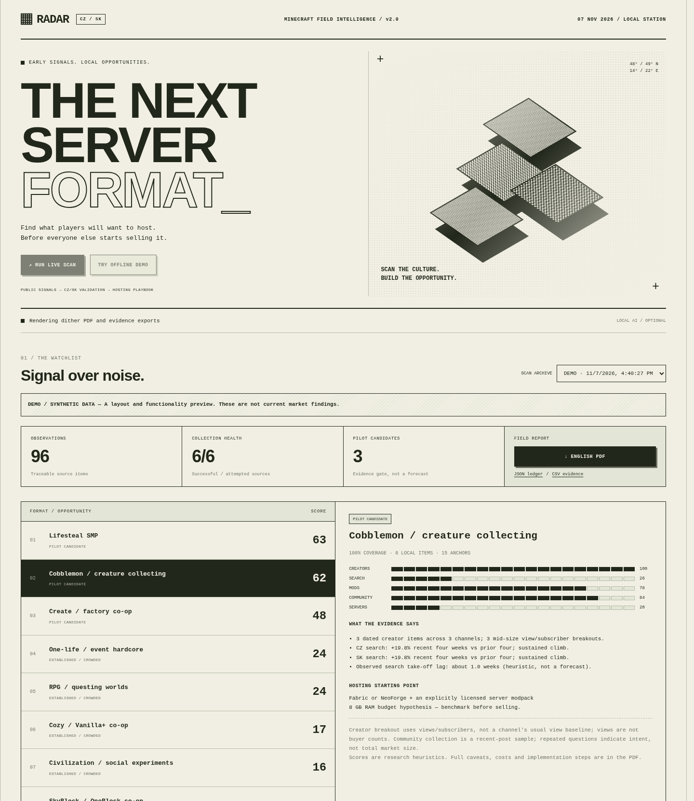

# CZ/SK Minecraft Trendfinder

An early-signal research tool for Minecraft hosting in **Czechia and Slovakia**. It collects creator, search, modpack, server-list and community signals, keeps historical snapshots, and generates an **English PDF** explaining the evidence, uncertainty, implementation and hosting offer.

A local **dither UI** and monochrome PDF use pixel bars, ordered dithering, paper tones and monospaced typography. Runs on your own PC. No subscription or GPU required.



**[Read the sample PDF](examples/demo-report.pdf)** — explicitly synthetic data, not current market findings.

## Start on Windows

1. Install **Python 3.11+** from [python.org](https://www.python.org/downloads/windows/), including the Windows `py` launcher.
2. Download or clone this repository into a writable folder.
3. Double-click **`Setup-Windows.cmd`**. It creates an isolated `.venv`, installs the package and writes `config.local.json`.
4. Double-click **`Start-Windows.cmd`**. Your default browser opens the local dashboard. Keep its console open while using it.
5. Choose **Try offline demo** to explore, then **Run live scan** for actual collection.

The dashboard binds only to `127.0.0.1:8765`. Reports are written under `data/reports/<run-id>/`. Credentials are optional environment variables, never entered in the dashboard or committed to Git. Internet access is required for live sources.

For a Python-free Windows app, run the **Build Windows app** GitHub Actions workflow and download its artifact, or use `scripts/build-windows.ps1` after setup. Distribute the entire `CZSK-Trendfinder` folder. That workflow also smoke-tests the executable's offline report. Windows binaries must be built on Windows; this cloud development session used Linux, so Windows CI results must be checked independently.

## What it checks

| Signal | Automatic collection | Limits / setup |
|---|---|---|
| YouTube creators | Recent search results, views, subscriber counts, configured channels; 50k–500k subscriber breakout proxy | `YOUTUBE_API_KEY` enables the official Data API. Public `yt-dlp` search is a less complete fallback, often blocked; dates/subscriber counts can be absent. No private cookies. |
| CZ/SK creators | Local queries, audio language, configurable creator names and channel IDs | Language/name heuristics do not verify audience geography. Defaults include SirYakari, GEJMR, MenT, House, Wedry, StudioMoonTV, Asimister and Duklock as name hints, not endorsements. |
| Google Trends | 12-month complete weekly series for CZ, SK and US; slope, four-week growth, sustained climb and spike checks | Unofficial `pytrends` adapter. Can be rate-limited; small-market terms can have insufficient volume. Indices are not search counts. |
| Modrinth | Popular/new modpacks plus watched-term searches; discovery of new pack hypotheses | Lifetime downloads are **not** called growth. Daily velocity uses repeat snapshots >=24h apart. Client-only packs are excluded; unknown server compatibility needs review. |
| CurseForge | Minecraft modpack API search and download snapshots | Optional `CURSEFORGE_API_KEY`; author license/redistribution rights still need review. |
| Server lists | Craftlist CZ, Minecraft-MP CZ/SK, Minecraft Server List newest page | First-page HTML samples, not total market share. Unknown markup yields a diagnostic. Tag-count change needs comparable snapshots, not inferred creation dates. |
| Communities | Public recent posts in r/admincraft, r/feedthebeast and r/Minecraft; hosting/setup intent matching | Reddit can block anonymous clients. Recent-post sample, not exhaustive history. |
| Discord | Last 100 messages per explicitly configured channel via an authorized bot | Optional `DISCORD_BOT_TOKEN`, channel access and message-content permissions. Message text and usernames are not persisted. Default is off. |
| TikTok / Facebook / other communities | Polling of **your authorized RSS/Atom feeds** and a CSV import folder | No unrestricted public-search API is assumed. Private Facebook groups, private Discord and TikTok-wide discovery need a permitted data source. No login bypass. |
| General reports | Google News RSS query for Minecraft server/modpack reporting | Lagging context only, **zero ranking weight**. |

The catalog covers Lifesteal, Cobblemon, Create, hardcore events, RPG, Vanilla+, civilization, SkyBlock/OneBlock, horror and crossplay. These are **hypotheses to measure**, not assertions that they are rising. Modrinth can discover unknown modpacks; dated creator videos with >=50k views can propose new named SMPs or "Minecraft but/ale" formats. Those proposals still need independent local validation. Add formats using `watch_terms` in the config.

Outages are visible in the dashboard, PDF and JSON. A scan with every source blocked still generates an **insufficient-evidence** report and exits with code `2`. There is no silent replacement with demo data.

## Commands

```powershell
# Windows, repository root, after setup
.venv\Scripts\python.exe -m trendfinder serve --config config.local.json --open
.venv\Scripts\python.exe -m trendfinder scan --config config.local.json
.venv\Scripts\python.exe -m trendfinder demo
.venv\Scripts\python.exe -m unittest discover -s tests -v
```

```bash
# Linux / macOS
python3 -m venv .venv
.venv/bin/python -m pip install -e .
.venv/bin/python -m trendfinder demo
.venv/bin/python -m trendfinder serve --open
```

`scan`, `demo` and `serve` accept `--data-dir PATH` and `--config FILE`. `python -m trendfinder init-config` writes config without overwriting an existing file. Live scans can take several minutes; adapters have bounded requests/timeouts. Do not run CLI and dashboard scans simultaneously against the same folder.

## Optional source credentials

No key is needed for demo, reports, dashboard, Modrinth or public HTML/RSS. Improve coverage by setting variables in the terminal that launches the app:

```powershell
# Placeholders, not working credentials. Use your own securely.
$env:YOUTUBE_API_KEY = "your-key"
$env:CURSEFORGE_API_KEY = "your-key"
$env:DISCORD_BOT_TOKEN = "your-authorized-bot-token"
.\Start-Windows.cmd
```

Enable **YouTube Data API v3** in Google Cloud. Search requests normally cost 100 quota units each; default five queries use about 500 plus video/channel lookups per scan. Watched channels add searches. Check current Google quota documentation before frequent scans. Public fallback cannot guarantee mid-size creator detection without subscriber metadata.

The app reads process environment variables, does not save credential values into reports, and does not load `.env` files. Scheduled tasks use their user's environment; variables set only in an interactive terminal do not automatically reach the task. Restart after changing settings.

## Local AI on a 4 GB VRAM GPU

Ranking, charts and the full report **do not need AI**. Local AI can suggest cited experiments; it cannot alter scores or create evidence.

1. Install [Ollama](https://ollama.com/) for Windows.
2. Run `ollama pull qwen2.5:3b` (the usual quantized 3B model is a practical starting point).
3. Set `"ai": {"enabled": true, "model": "qwen2.5:3b"}` in `config.local.json`, start Ollama, then scan.

The app requests **2,048 context tokens**, short JSON and one-minute model keep-alive. A 3B Q4 model often fits a 4 GB budget, but memory depends on GPU, drivers and backend and may spill to CPU. Check `ollama ps` and use a smaller model if needed. No GPU/Ollama model was available here; GPU performance is untested. Missing models, timeouts or invalid citations leave the deterministic report intact.

Any compatible Ollama model is configurable, including a Laya variant if an Ollama-compatible build exists. The app does not assume an ambiguously named model exists or fits memory. Only loopback endpoints are accepted. Retrieved text is untrusted, AI notes are labeled hypotheses, and their evidence IDs are validated.

## Inside the PDF

- Watchlist with pilot / watch / established / insufficient-evidence decisions.
- Collection health, scoring methods, uncertainty and source citations.
- Creator activity, local search plots, observed international/local lag, modpack velocity and hosting intent.
- Template stack, version/license review, backup/restore and load-test steps.
- Configurable infrastructure, RAM, support and payment costs; contribution before tax/acquisition.
- Czech and Slovak short-video copy and a 14-day validation sprint.
- Optional AI experiment notes, JSON raw data and spreadsheet-safe CSV.

Capacity, price and pilot targets are **assumptions**, not performance promises. The application does not deploy production servers or assert redistribution rights for you. Measure installation time, conversion, retention, tick performance and support effort before publishing a Žuvačka/Rohlík-style one-click offer.

## Daily scans on Windows

```powershell
powershell -File scripts\Schedule-Windows.ps1 -Time "08:00"
```

Registers a daily task for the current user, without elevation or a saved password. The PC must be available; missed runs start when possible. Review it in Task Scheduler. Remove with `Unregister-ScheduledTask -TaskName "CZSK Minecraft Trendfinder" -Confirm:$false`. Script execution follows your Windows policy; do not weaken system-wide policy just to run it.

Live runs append to `data/history.sqlite3`; demos never enter live snapshots. Retain at least a week of daily scans before interpreting velocity. Counter changes and first-page listing composition can distort comparisons; review original evidence.

## Configuration and development

- [Example config](config.example.json)
- [Methods and limitations](docs/METHODS.md)
- [Source setup, feeds and imports](docs/SOURCES.md)
- [Validation performed](docs/VALIDATION.md)

GitHub Actions runs offline tests/PDF generation on Windows and Linux, Python 3.11/3.12. A manual workflow builds a Windows executable. Tests use fixtures/mocks; live endpoint changes need real-source checks. Credentials and local data are ignored by Git.

## Original Craftlist analyzer

`craftlist_analyzer.py` and `craftlist_cz_market_report.pdf` are retained as a separate legacy tool. Install its dependencies (`playwright requests beautifulsoup4 reportlab matplotlib numpy`) and run `playwright install chromium` to use it.

Use `python craftlist_analyzer.py --out your-new-report.pdf`; its default overwrites the tracked example. The old script is not required by the new radar.

Licensed under [Apache-2.0](LICENSE).
